# 🛰️ GeoSentinel — AI-Powered Landslide Detection System

Real-time landslide detection and segmentation from satellite and aerial drone imagery powered by **YOLOv8-Seg**, featuring interactive GIS mapping, historical heatmap analytics, and automated emergency alert dispatching via Streamlit.

---

## 📋 Table of Contents
1. [Project Overview & Objectives](#-project-overview--objectives)
2. [System Features & Status](#-system-features--status)
3. [Dataset & Augmentation Pipeline](#-dataset--augmentation-pipeline)
4. [Model Architecture & Training](#-model-architecture--training)
5. [Performance Metrics & Evaluation](#-performance-metrics--evaluation)
6. [Detection Results & UI Walkthrough](#-detection-results--ui-walkthrough)
7. [Operational Workflow & Disaster Response](#-operational-workflow--disaster-response)
8. [Repository Structure](#-repository-structure)
9. [Installation & Quickstart](#-installation--quickstart)
10. [Dataset Bias, Limitations & Roadmap](#-dataset-bias-limitations--roadmap)
11. [References & Contributors](#-references--contributors)

---

## 🌍 Project Overview & Objectives

Landslides cause severe infrastructure damage and casualties in hilly, remote regions where ground access is blocked and communication is fragile. **GeoSentinel** provides an end-to-end computer vision and emergency response pipeline that converts raw satellite and drone captures into actionable disaster intelligence within seconds.

* **High-Precision Segmentation:** Identifies unstable slope boundaries using YOLOv8 instance segmentation.
* **Triage & Scoring:** Computes confidence scores and classifies risk levels (`HIGH`, `LOW`, `NONE`).
* **Geospatial Pinning:** Renders interactive Folium maps with GPS coordinates and a 1 km evacuation perimeter.
* **Drone Video Analytics:** Frame-by-frame inference on drone footage with timeline charts and annotated video export.
* **Automated Early Warnings:** Multi-channel alerting (SMS, rich HTML email, and local speech warnings).
* **Historical Heatmaps:** Logs coordinate and risk data to a persistent CSV database to monitor hazard zones over time.

---

## ⚡ System Features & Status

| Feature | Tech Stack | Operational Status & Details |
|---|---|---|
| **📷 Image Analysis** | Ultralytics YOLOv8, Pillow | **Active:** Instant mask overlay, confidence score, and risk badge. |
| **🎞️ Drone Video Scan** | OpenCV, NumPy | **Active:** Frame-by-frame analysis (MP4/AVI/MOV/GIF), timeline bar, annotated video download. |
| **🗺️ Geolocation Map** | Folium, Streamlit-Folium | **Active:** CartoDB dark-matter map, danger/safe markers, 1 km radius evacuation zone. |
| **🔥 Historical Heatmap** | Folium HeatMap Plugin, Pandas | **Active:** Density heatmap generated dynamically from `data/landslide_data.csv`. |
| **💾 Detection Logging** | Python CSV Engine | **Active:** Persistent logging of latitude, longitude, confidence %, timestamp, and location name. |
| **📱 SMS Alert** | Twilio REST API | **Configurable:** Pre-built in `src/features.py`; disabled in public demo due to API credentials. |
| **📧 HTML Email Alert** | SendGrid API | **Configurable:** Sends HTML emergency alert with annotated detection image attached; requires API key. |
| **🔊 Audio Voice Alert** | pyttsx3 | **Local Mode:** In-browser synthesized voice prompt instructing slope evacuation. |

---

## 📦 Dataset & Augmentation Pipeline

The model was trained on a curated landslide segmentation dataset aggregated from multiple satellite and aerial sources:
* 🔗 [Roboflow Landslide Segmentation Dataset](https://universe.roboflow.com/sujans-workspace/landslides-2/dataset/3)
* 🔗 [Kaggle Landslide4Sense](https://www.kaggle.com/datasets/saurabhshahane/landslide4sense)
* 🔗 [NASA Global Landslide Catalog](https://gpm.nasa.gov/landslides/index.html)

### Data Splits & Format
* **Raw Collection:** 327 original satellite/aerial images
* **Augmented Dataset:** 821 annotated images (3× multiplier on training split)
* **Annotation Format:** YOLO polygon segmentation coordinates (`.txt`)
* **Classes:** Single-class detection & segmentation (`0: landslide`)

| Split | Images | Proportion | Preprocessing & Augmentation Pipeline | Settings |
|---|---|---|---|---|
| **Train** | 711 | 87% | **Auto-Orient (EXIF)** | Applied |
| **Valid** | 70 | 9% | **Resize (Fit black edges)** | 640 × 640 px |
| **Test** | 40 | 5% | **Horizontal Flip / Rotation** | 50% prob / ±5° |
| **Total** | **821** | **100%** | **Brightness / Blur / Noise** | ±20% / 1.5 px / 1.33% pixels |

---

## 🧠 Model Architecture & Training

GeoSentinel fine-tunes **YOLOv8n-Seg** (Nano Segmentation) using transfer learning from COCO pretrained weights.

```text
YOLOv8-Seg Architecture
├── Backbone       : CSPDarknet (Cross Stage Partial feature extraction)
├── Neck           : PANet (Path Aggregation Network for multi-scale feature fusion)
├── Detection Head : Decoupled anchor-free head (bounding box regression + objectness)
└── Mask Head      : Prototype-based instance segmentation (ProtoNet generating 32 mask coefficients)
```

### Hyperparameters & Training Specs

| Parameter | Setting | Parameter | Setting |
|---|---|---|---|
| **Base Model** | `yolov8n-seg.pt` (COCO) | **Optimizer** | AdamW |
| **Input Resolution** | 640 × 640 px | **Learning Rate** | Initial: 0.01 → Final: 0.0001 |
| **Scheduled Epochs** | 100 (best weights saved at plateau) | **Weight Decay** | 0.0005 |
| **Batch Size** | 16 | **Augmentation** | Mosaic, MixUp, HSV jitter, Flip |
| **Hardware** | NVIDIA GPU (CUDA acceleration) | **Exported Weights** | `best.pt` (23.9 MB) |

---

## 📊 Performance Metrics & Evaluation

Evaluation on the independent **test set (40 images)** demonstrates high precision and balanced boundary delineation:

| Task Domain | Precision | Recall | mAP@0.50 | mAP@0.50:0.95 | Key Insight |
|---|---|---|---|---|---|
| **Bounding Box** | **0.843** | **0.802** | **0.837** | **0.448** | Strong object localization and identification across varying lighting. |
| **Segmentation Mask**| **0.844** | **0.679** | **0.731** | **0.342** | High mask fidelity; conservative recall minimizes false slope alarms. |

### Evaluation Curves & Matrix

| Training Progression (`results.png`) | Confusion Matrix (`confusion_matrix.png`) |
|:---:|:---:|
| 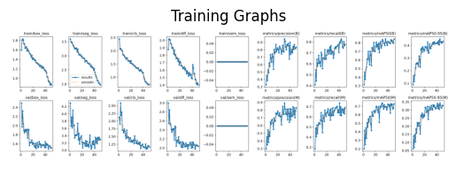 | 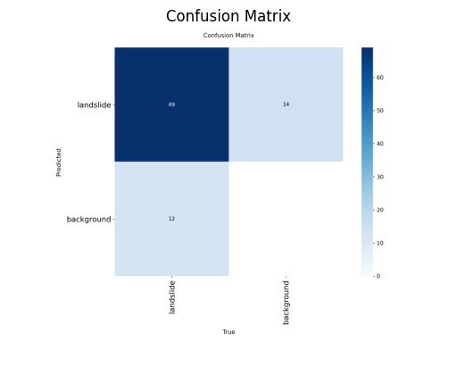 |
| **Precision-Recall Curve (`pr_curve.png`)** | **F1-Score Confidence Curve (`mask_f1_curve.png`)** |
| 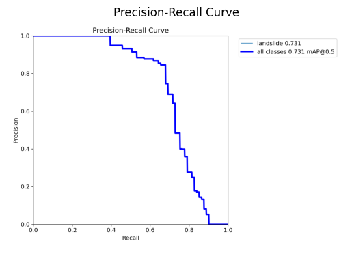 | 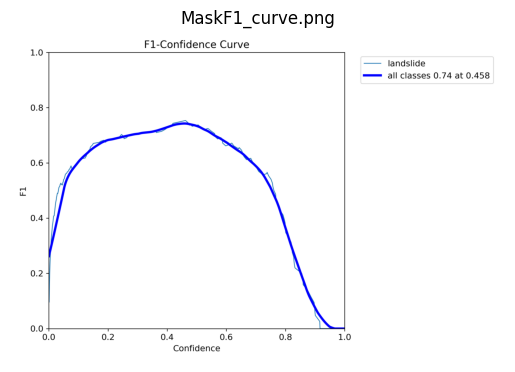 |

* **Confusion Matrix Breakdown:** 69 True Positives, 14 False Negatives (landslides missed as background), 12 False Positives (terrain misclassified as landslide).
* **PR Curve:** Area under curve reaches **mAP@0.5 ≈ 0.73**, proving consistent detection at practical recall thresholds.
* **F1 Curve:** Peak F1 score of **0.74 achieved at confidence ~0.45**, establishing **0.45–0.50** as the optimal operational threshold.

---

## 🖼️ Detection Results & UI Walkthrough

### Test Set Predictions
| Sample 1: Active Landslide Mask (`landslide1.png`) | Sample 2: Scarp Boundary (`landside.png`) | Test Matrix Collage (`mode_prediction.png`) |
|:---:|:---:|:---:|
| 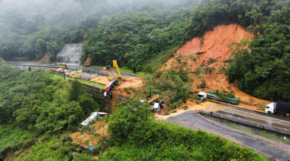 | 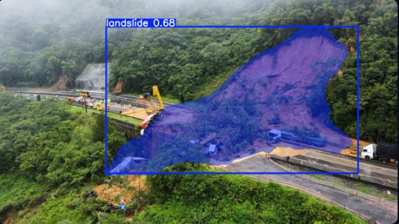 | 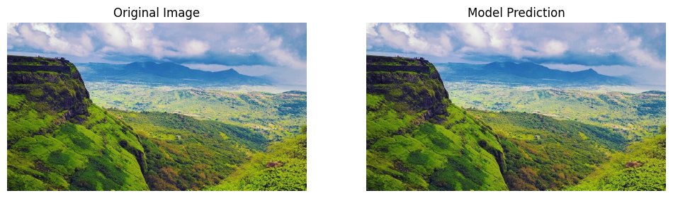 |

### Application Interface Walkthrough
| Safe Terrain / No Landslide | Image Detection & Confidence | Risk Map & SMS Alert Panel |
|:---:|:---:|:---:|
| 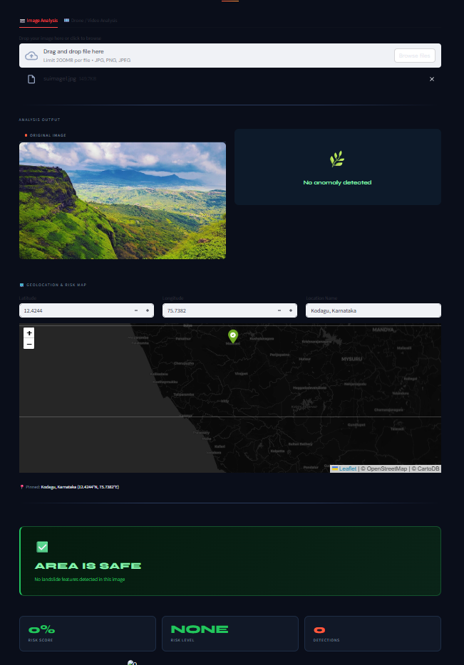 | 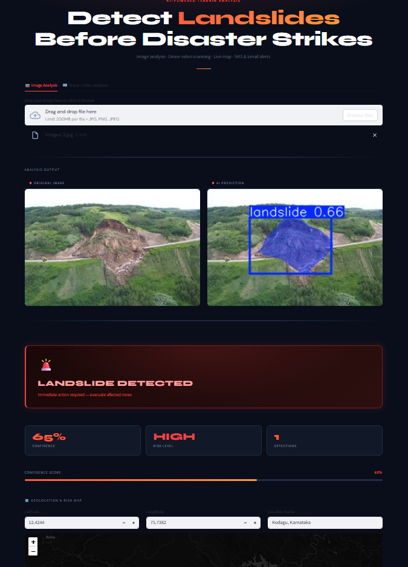 | 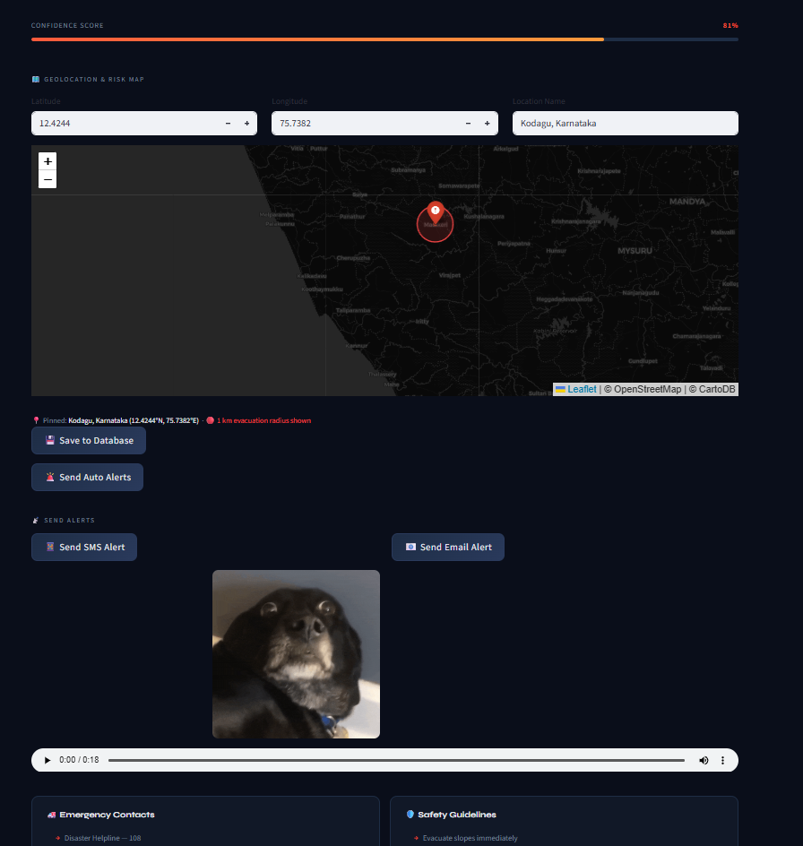 |
| **Drone Video Input** | **Drone Video Output & Timeline** | **Historical Landslide HeatMap** |
| 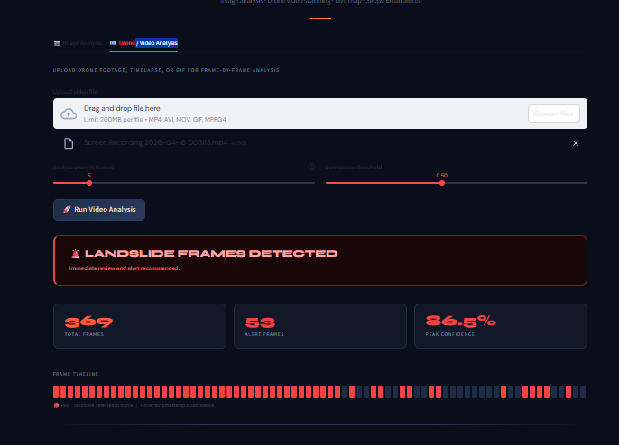 | 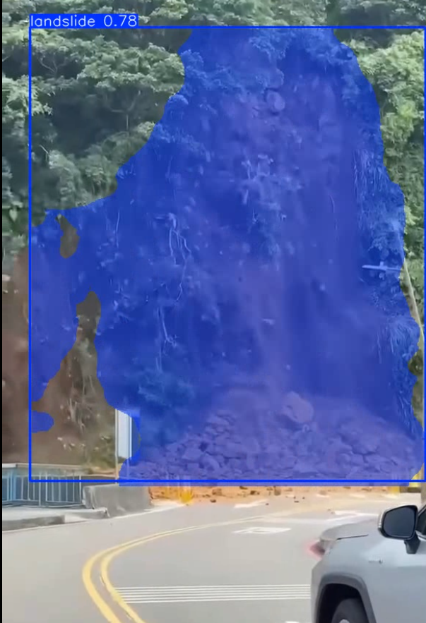 | 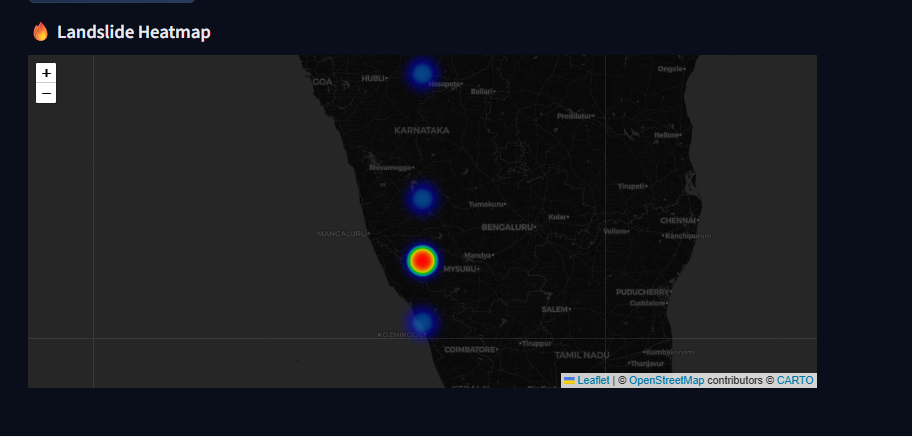 |

---

## 🔄 Operational Workflow & Disaster Response

```text
[Satellite / Drone Capture] ──> [YOLOv8-Seg 640×640] ──> [Confidence & Mask Evaluation]
                                                                   │
               ┌───────────────────────────────────────────────────┴────────────────────────────────────────┐
               ▼                                                   ▼                                        ▼
   [HIGH RISK (Conf ≥ 0.50)]                           [LOW RISK (Conf < 0.50)]                     [NO RISK DETECTED]
   • Red Danger Banner & Siren                         • Green Caution Banner                       • Safe Terrain UI
   • Folium 1 km Evacuation Map                        • Terrain Monitoring Advisory                • Baseline Logged
   • Automated SMS + Email Dispatch                    • CSV Database Log                           • System Standby
   • Persistent CSV Entry Logging
   • HeatMap Surface Regeneration
```

### Remote Village Emergency Scenario
1. **Disruption:** Rainfall triggers landslides blocking rural roads and severing landline connectivity.
2. **Aerial Survey:** A field drone collects high-resolution footage over suspected valleys.
3. **Automated Triage:** GeoSentinel detects slope failures, isolates GPS coordinates, and defines a 1 km danger perimeter.
4. **Actionable Alert:** Disaster management authorities receive SMS coordinates and HTML emails with visual mask attachments for targeted evacuation.

---

## 📁 Repository Structure

```text
GeoSentinel-Landslide-Detection-System/
├── .devcontainer/
│   └── devcontainer.json        # Codespaces container development environment
├── assets/
│   ├── examples/                # Authentic landslide test images (landslide1.png, landside.png)
│   └── ui/                      # Streamlit UI screenshots (safe_img, ui_img1–3, ui_vid1–2)
├── data/
│   ├── data.yaml                # YOLO dataset configuration
│   └── landslide_data.csv       # Persistent detection logs (268 historical coordinate records)
├── docs/
│   ├── README.dataset.txt       # Roboflow dataset license and workspace attribution
│   └── README.roboflow.txt      # Data preprocessing and augmentation parameters
├── notebooks/
│   └── model.ipynb              # YOLOv8 segmentation training and evaluation notebook
├── results/                     # Training curves, confusion matrix, PR/F1 plots, test collages
├── src/
│   ├── __init__.py              # Python package marker
│   ├── database.py              # Resilient CSV logging engine with dynamic path resolution
│   └── features.py              # Twilio SMS, SendGrid Email, Video scanner, and Folium Map UI
├── .gitignore                   # Version control rules
├── app.py                       # Primary Streamlit web application
├── app1.py                      # Backward-compatibility application launcher
├── best.pt                      # Trained YOLOv8 segmentation weights (23.9 MB)
├── data.yaml                    # Root dataset configuration file
├── packages.txt                 # Debian/Ubuntu system libraries (libgl1)
├── requirements.txt             # Python runtime dependencies
└── README.md                    # Project documentation
```

---

## 🚀 Installation & Quickstart

### 1. Clone & Set Up Environment
```bash
git clone https://github.com/Sujan-lab-cell/GeoSentinel-Landslide-Detection-System.git
cd GeoSentinel-Landslide-Detection-System
python -m venv venv
# On Windows: venv\Scripts\activate | On Linux/macOS: source venv/bin/activate
pip install -r requirements.txt
```

### 2. Launch Streamlit Application
```bash
streamlit run app.py
```
*(Running `streamlit run app1.py` also works via the built-in backward-compatibility wrapper).*

### 3. Optional Alert Configuration
To activate live SMS and Email alerts, add your credentials in `src/features.py` (or set environment variables):
* **Twilio:** `TWILIO_ACCOUNT_SID`, `TWILIO_AUTH_TOKEN`, `TWILIO_FROM_NUMBER`, `TWILIO_TO_NUMBER`
* **SendGrid:** `SENDGRID_API_KEY`, `ALERT_FROM_EMAIL`, `ALERT_TO_EMAIL`

---

## ⚠️ Dataset Bias, Limitations & Roadmap

### Dataset Bias & Mitigation
* **Challenge:** The initial dataset was heavily weighted with active landslide images, causing the model to over-predict landslides in barren rocky or brown soil regions.
* **Mitigation:** Explicit negative background samples (non-landslide forested hills, bare soil, and standard rural roads) were integrated, reducing false alarms and improving true negative balance.

### Current Limitations
* SMS and email dispatching require third-party paid API credentials, disabled by default in cloud demos.
* Heavy cloud cover or extreme sensor blur in raw satellite feeds can lower segmentation mask recall.

### Future Improvements
* **Multi-Hazard Detection:** Expanding classes to flood inundation, mudslides, and collapsed roadways.
* **Live Satellite Ingestion:** Automated scraping from Copernicus Sentinel-2 and NASA MODIS open APIs.
* **Mobile Field App:** Lightweight offline-first mobile app for rescue workers with push notifications (FCM).

---

## 📚 References & Contributors

1. **Ultralytics YOLOv8:** [GitHub Repository](https://github.com/ultralytics/ultralytics)
2. **Streamlit Framework:** [Streamlit Docs](https://streamlit.io)
3. **Folium GIS Mapping:** [Folium Documentation](https://python-visualization.github.io/folium)
4. **Twilio REST API:** [Twilio Docs](https://www.twilio.com/docs/sms)
5. **SendGrid Email API:** [SendGrid Docs](https://docs.sendgrid.com)
6. **Roboflow Computer Vision:** [Roboflow Platform](https://roboflow.com)
7. **NASA Global Landslide Catalog:** [NASA GPM](https://gpm.nasa.gov/landslides)
8. **Kaggle Landslide4Sense:** [Kaggle Dataset](https://www.kaggle.com/datasets/saurabhshahane/landslide4sense)
9. **OpenCV Computer Vision:** [OpenCV Library](https://opencv.org)
10. **pyttsx3 Text-to-Speech:** [PyPI Package](https://pypi.org/project/pyttsx3)
11. **Bhushan, B., & Solomatine, D. P. (2021):** *Machine learning in landslide studies: Novel insights and future challenges.* Earth-Science Reviews.
12. **Ghorbanzadeh, O., et al. (2019):** *Evaluation of different machine learning methods and deep learning CNNs for landslide detection.* Remote Sensing.

### 👨‍💻 Project Authors & Credits
* **Sujan KS**
* **Prajwal Ravi Devadiga**
* **Vinayak J Prabhu**

<p align="center">
  <b>GeoSentinel AI</b> — Detect landslides before disaster strikes 🛰️<br>
  <i>Built for rapid disaster response · Academic & Emergency Research</i>
</p>
